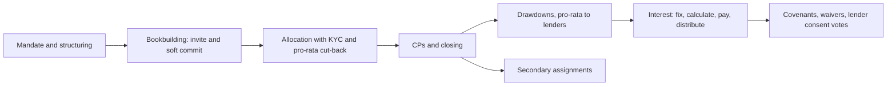

# Syndicated Loans on Salesforce

An open-source reference implementation of the **end-to-end syndicated loan process** on the Salesforce platform: architecture diagrams, BPMN workflows, a complete data model and a small, working Salesforce project that proves the design.

[](https://github.com/PoorvySharma/syndicated-loans-salesforce/actions/workflows/ci.yml)
License: [Apache-2.0](LICENSE)

> Replace `OWNER` in the badge URL with your GitHub user or organisation.

## What it covers



| You asked for | Where it is |
|---|---|
| **`/docs`** architecture (C4), BPMN workflows, detailed explanations | [`docs/`](docs/README.md): [C4 diagrams](docs/02-architecture-c4.md), [BPMN (5 processes)](docs/03-process-workflows.md), [domain primer](docs/01-domain-primer.md), [business rules](docs/05-business-rules.md), [ADRs](docs/adr/) |
| **`/schemas`** complete data model | [`schemas/`](schemas/README.md): [`data-model.json`](schemas/data-model.json) (16 objects, 132 fields), [data dictionary](schemas/data-dictionary.md), [ERD](schemas/erd.md), [state machines](schemas/state-machines.md), event and API JSON Schemas |
| **Lightweight functional Salesforce project** | [`force-app/`](force-app/main/default): 14 custom objects and a platform event, Apex services, REST API, triggers, a Lightning console, permission sets, 6 Apex test classes (plus a data factory) including an end-to-end lifecycle test |

## Quick start (about 10 minutes)

Prerequisites: [Salesforce CLI](https://developer.salesforce.com/tools/salesforcecli) and a Dev Hub org (a free Developer Edition org with Dev Hub enabled works).

```bash
git clone https://github.com/OWNER/syndicated-loans-salesforce.git
cd syndicated-loans-salesforce

sf org login web --set-default-dev-hub
./scripts/bootstrap-scratch-org.sh        # create scratch org, deploy, permission set, seed data, run tests, open console
```

Then in the **Syndication Console** pick *Project Atlas (Demo)* and walk the lifecycle with the buttons: **Allocate → Close facility** (tick *Conditions Precedent Satisfied* on the deal first) **→ Request drawdown → Validate & notify → Confirm funding → Open interest period → Fix rate → Calculate → Mark paid → Distribute**.

Prefer no UI? Run the whole lifecycle as a script and read the trace:

```bash
sf apex run --file scripts/apex/run-lifecycle.apex
```

Details, Developer Edition/sandbox steps and troubleshooting: [docs/08-deployment-and-testing.md](docs/08-deployment-and-testing.md).

## Proof that it works

- **`LifecycleEndToEndTest`** runs the complete lifecycle in one transaction and asserts reconciliation at every step (allocations sum to the facility size; drawdown shares sum to the drawdown; interest distributions sum to the interest received to the cent; lender funded holds equal the facility drawn amount).
- 16 documented [business rules](docs/05-business-rules.md), each mapped to enforcing code and a test.
- Offline checks that need no org: `python3 tools/validate_repo.py`, `tools/validate_schemas.py`, `tools/verify_math.py`.

> **Honest status.** The metadata, Apex and LWC were authored and statically verified, but have not yet been deployed to a live org by the package author. Deploy to a scratch org and run the tests first; see [verification status](docs/09-roadmap-and-limitations.md#verification-status-read-this-first). Known gaps (multi-currency, fee accrual, amortisation, compounded RFR interest, portal) are listed there too.

## Repository layout

```
docs/                    C4 diagrams, BPMN (.bpmn + .svg), domain, rules, security, integration, ADRs
schemas/                 data-model.json (source of truth), dictionary, ERD, state machines, JSON Schemas, examples
force-app/main/default/  objects, fields, layouts, tabs, app, permission sets, Apex, triggers, LWC, flexipage
scripts/                 seed-demo-data.apex, run-lifecycle.apex, bootstrap-scratch-org.sh
tools/                   generators (metadata, BPMN) and offline validators
config/                  scratch org definition
.github/workflows/       CI (offline checks always; scratch-org tests when SFDX_AUTH_URL is set)
```

## How the pieces stay consistent

`schemas/data-model.json` is the single source of truth. `tools/generate_metadata.py` turns it into the Salesforce objects, fields, layouts, tabs, app, permission sets, the data dictionary and the ERD. `tools/generate_bpmn.py` turns one process definition into BPMN XML, SVG and step tables. CI regenerates both and fails if anything differs from what is committed ([ADR-001](docs/adr/ADR-001-single-source-data-model.md)).

## Contributing

Issues and pull requests are welcome; see [CONTRIBUTING.md](CONTRIBUTING.md). Security reports: [SECURITY.md](SECURITY.md).

## Disclaimer

This is a reference implementation for learning and as a starting point. It is **not** legal, compliance or financial advice and has not been audited for production use. Market conventions follow common LMA-style practice but real facility agreements differ.

## License

Apache License 2.0. See [LICENSE](LICENSE). Salesforce, Lightning and Apex are trademarks of Salesforce, Inc.; this project is independent and not affiliated with or endorsed by Salesforce.
