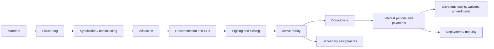

# 1. Domain primer: syndicated loans end to end

A **syndicated loan** is a single loan provided by a group of lenders (the *syndicate*) to one borrower, under one set of documents and administered by one *agent*. It exists because the loan is too large or too risky for one lender.

This page gives the vocabulary used throughout the project and shows which parts of the lifecycle the code covers.

## Actors

| Actor | Role in the transaction | Where it lives in the model |
|---|---|---|
| **Borrower** | Receives the funds, pays interest, gives covenants | `Account`, `Syndicated_Deal__c.Borrower__c` |
| **Arranger / Bookrunner** | Structures the deal, runs the syndication, invites lenders | `Syndicated_Deal__c.Arranger__c` |
| **Lender** | Commits a share, funds drawdowns pro-rata, receives interest, votes on amendments | `Lender_Commitment__c.Lender__c` |
| **Facility Agent** | Administers the loan day to day: CPs, rate fixing, notices, payments, consent collection | `Syndicated_Deal__c.Agent__c` |
| **Compliance** | Owns KYC / sanctions evidence | `KYC_Check__c` |

One institution can play several roles (a bank is often arranger, agent and lender). That is why institutions are a single object with a role multi-select (see [ADR-002](adr/ADR-002-account-for-institutions.md)).

## Lifecycle

| Stage | What happens | Implemented in v0.1 | Process model |
|---|---|---|---|
| Mandate, structuring | Terms agreed with borrower; facilities (tranches) defined | Data model, standard UI | [BPMN 01](bpmn/01-origination-and-allocation.md) |
| Syndication | Lenders invited; **soft commitments** collected | Yes | BPMN 01 |
| Allocation | Soft commitments scaled back pro-rata if oversubscribed; KYC/sanctions gate | Yes (`SyndicationAllocator`) | BPMN 01 |
| Documentation and CPs | **Conditions precedent** delivered; agent confirms | Checkbox gate on the deal | BPMN 01 |
| Closing | Commitments become **Signed**, facility **Active** | Yes (`ClosingService`) | BPMN 01 |
| Drawdown | Borrower requests funds; agent validates; each lender funds its share | Yes (`DrawdownService`) | [BPMN 02](bpmn/02-drawdown-and-funding.md) |
| Interest | Base rate fixed per period; interest calculated; lenders paid pro-rata | Yes (`InterestService`) | [BPMN 03](bpmn/03-interest-and-distribution.md) |
| Covenants, waivers | Borrower tests compliance; breaches trigger waiver votes | Yes (`CovenantService`, `ConsentService`) | [BPMN 04](bpmn/04-covenant-and-consent.md) |
| Secondary market | Lenders sell down holdings | Yes, basic (`AssignmentService`) | [BPMN 05](bpmn/05-secondary-assignment.md) |
| Fees | Arrangement, agency, commitment fees | Data model only | — |
| Repayment schedules, prepayments | Amortisation and voluntary prepayment | Full drawdown repayment only | — |

## Glossary

| Term | Meaning |
|---|---|
| **Facility** | One tranche of a deal (Term Loan A, Term Loan B, RCF). Own pricing, maturity and lender group. |
| **Commitment** | The maximum a lender agrees to lend under a facility. |
| **Soft commitment** | An indicative, non-binding amount offered during bookbuilding. |
| **Cut-back** | Reducing soft commitments pro-rata when the book is oversubscribed. |
| **Oversubscription** | Total soft commitments divided by the facility size (1.5x = 150% covered). |
| **Conditions precedent (CPs)** | Documents and confirmations required before the first drawdown. |
| **Drawdown / utilisation** | The borrower taking cash under a facility. |
| **Value date** | The date funds move for a drawdown and interest starts accruing. |
| **Interest period** | The accrual window (typically 1, 3 or 6 months) for which a base rate is fixed. |
| **Base / reference rate** | Benchmark such as SOFR, EURIBOR, SONIA. |
| **Margin** | The spread over the base rate, in basis points (bps). |
| **Floor** | Minimum for the base rate (here 0%): a negative benchmark is treated as 0. |
| **Day-count convention** | How a period converts to a year fraction: ACT/360, ACT/365, 30E/360. |
| **Super Majority Lenders** | Lenders holding at least a set share (commonly 66⅔%) of commitments, who can approve most waivers. |
| **Unanimous / all-lender matter** | Changes to core economics that need 100% consent. |
| **Assignment** | Sale of a lender's commitment to a new lender, usually with agent and borrower consent. |
| **KYC / Sanctions** | Know-your-customer and sanctions screening required before a party can hold an exposure. |

> The conventions here follow common market practice (LMA-style documentation). Real facility agreements differ in detail; this project is a reference implementation of the process, not legal or financial advice.
