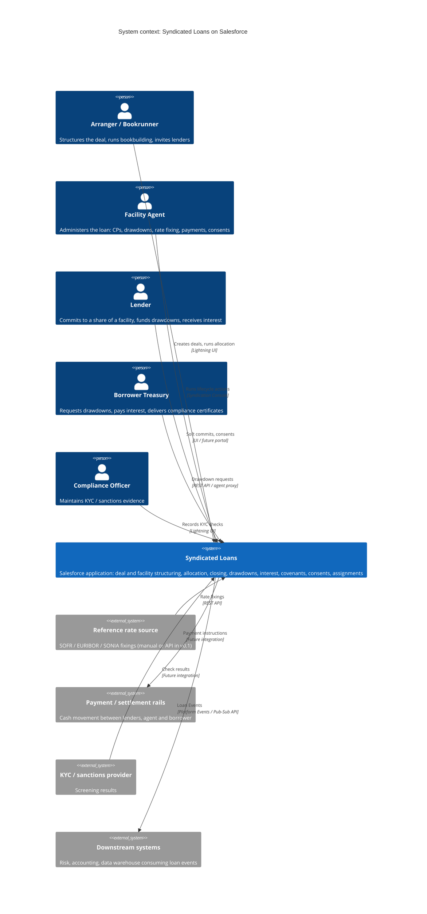
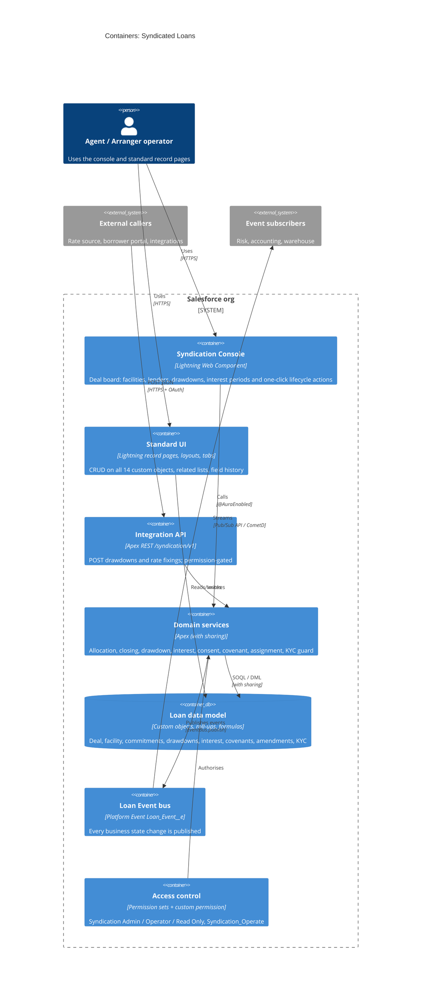
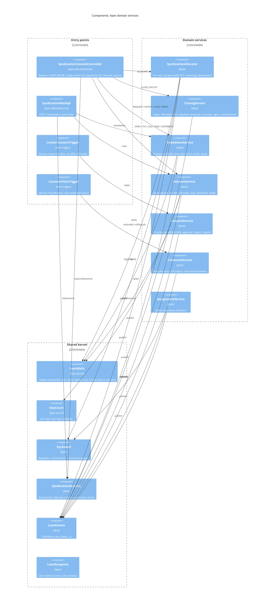
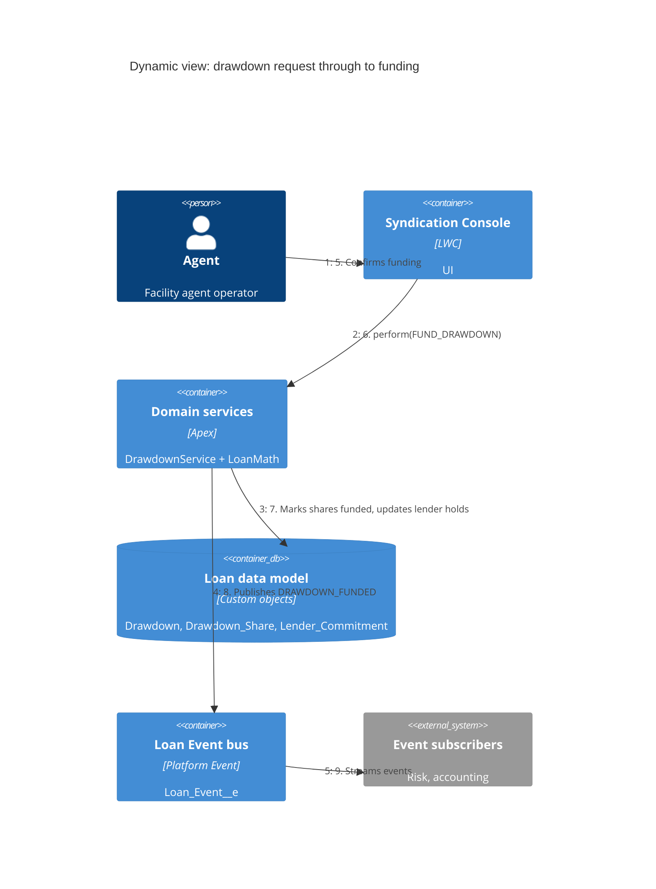
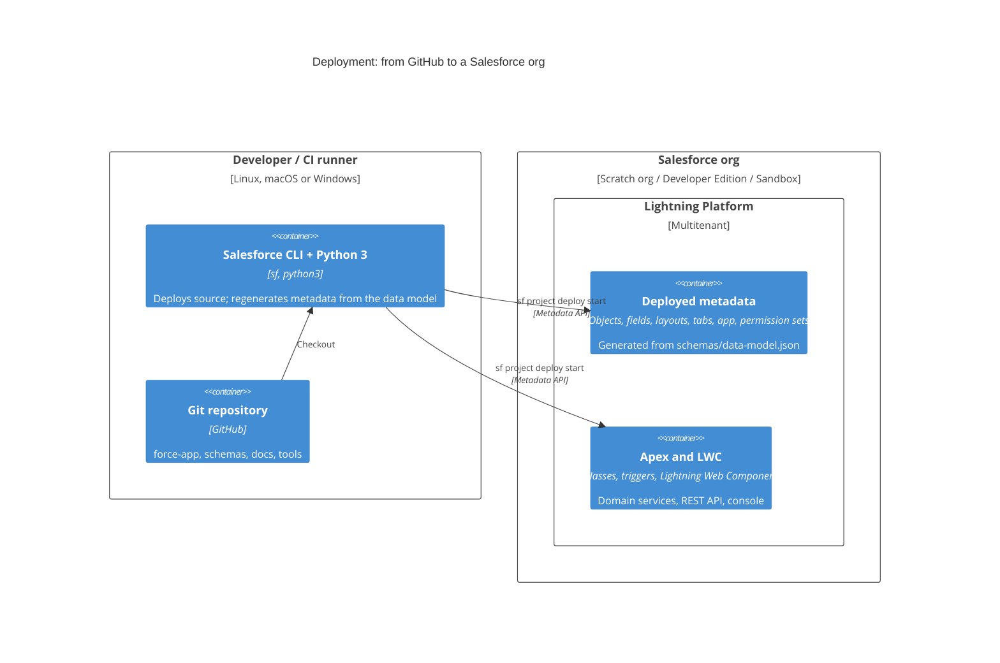

# 2. Architecture (C4 model)

The architecture is documented with the [C4 model](https://c4model.com): four zoom levels from system context down to components, plus a dynamic view of one key scenario and a deployment view. All diagrams are Mermaid, so they render directly on GitHub and live next to the code.

| Level | Question it answers | Section |
|---|---|---|
| 1. System context | Who uses the system and what does it talk to? | [2.1](#21-level-1--system-context) |
| 2. Containers | What are the deployable/runtime building blocks? | [2.2](#22-level-2--containers) |
| 3. Components | How is the Salesforce application structured inside? | [2.3](#23-level-3--components) |
| Dynamic | How do the parts collaborate for a drawdown? | [2.4](#24-dynamic-view--drawdown-request) |
| Deployment | Where does it run? | [2.5](#25-deployment-view) |

> Scope note: external systems (payment rails, rate source, KYC provider, document vault) are drawn because the design has explicit integration points for them. In v0.1 they are **not implemented**; the project proves the core lifecycle inside Salesforce. See [09-roadmap-and-limitations.md](09-roadmap-and-limitations.md).

## 2.1 Level 1 — System context

## 2.2 Level 2 — Containers

In Salesforce terms a "container" is a separately deployable or independently running unit of the platform.

Key decisions behind this shape are recorded as ADRs: [ADR-001](adr/ADR-001-single-source-data-model.md) (generated metadata), [ADR-004](adr/ADR-004-apex-service-layer.md) (service layer), [ADR-005](adr/ADR-005-platform-events.md) (events).

## 2.3 Level 3 — Components

The internals of the *Domain services* container and its entry points.

Design rules visible in the diagram:

- **Entry points contain no business logic.** The console, REST API and triggers only authorise, parse and delegate.
- **Money maths is pure and isolated** (`LoanMath`, `DayCount`): no SOQL or DML, so it is unit-testable without data.
- **Services never call each other sideways**, except through the shared kernel. Orchestration across services happens in the entry point or the caller.
- **Every service publishes a `Loan_Event__e`** after its state change, giving integration and audit a single stream.

## 2.4 Dynamic view — drawdown request

## 2.5 Deployment view

## Rendering tips

- GitHub renders these natively. If a viewer shows raw text, paste the block into <https://mermaid.live>.
- Mermaid's C4 support is still marked experimental upstream; layout can vary slightly between versions. The *content* (elements and relationships) is the source of truth.
