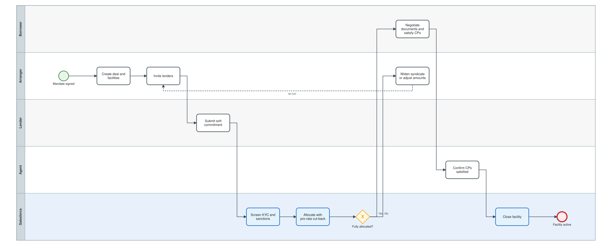
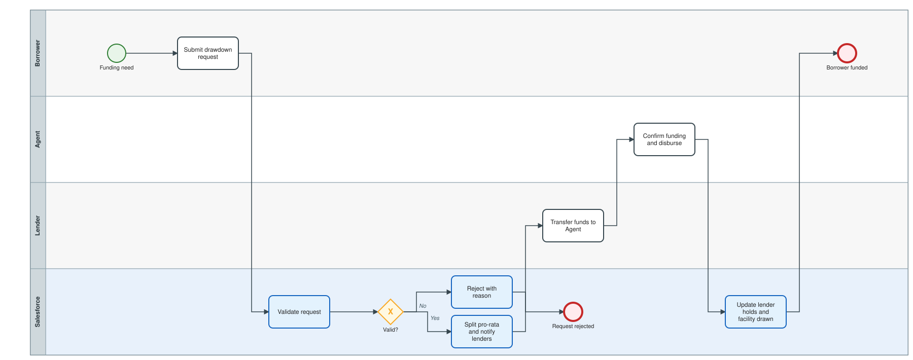
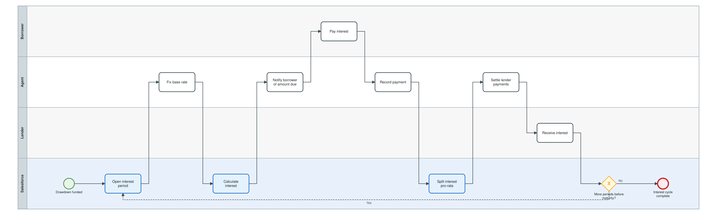
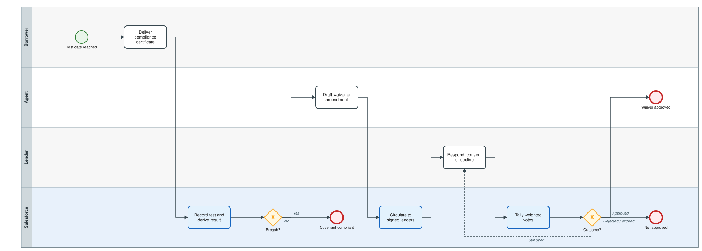
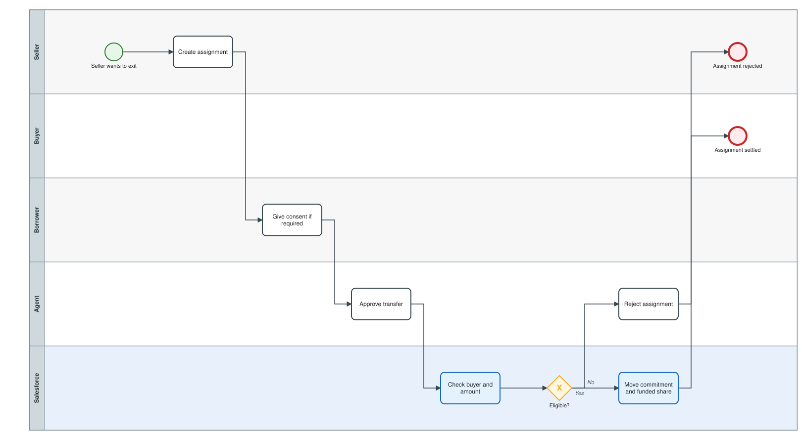

# 3. Process workflows (BPMN)

Five processes cover the end-to-end lifecycle. Each is available as:

- **BPMN 2.0 XML** (`.bpmn`) — editable in [bpmn.io](https://demo.bpmn.io), Camunda Modeler or any BPMN tool;
- **SVG preview** — rendered inline below and on GitHub;
- **Step table** — every step mapped to the Apex class, object or event that implements it.

All three artefacts are generated from one definition in [`tools/generate_bpmn.py`](../tools/generate_bpmn.py), so they cannot drift apart. Edit the definition and re-run `python3 tools/generate_bpmn.py`.

Legend: white rounded box = manual task; blue rounded box = automated by this project; diamond = exclusive gateway; dashed arrow = loop back; green circle = start; red circle = end.

## 3.1 Origination, bookbuilding and allocation

[Step table and editable model](bpmn/01-origination-and-allocation.md)

## 3.2 Drawdown and funding

[Step table and editable model](bpmn/02-drawdown-and-funding.md)

## 3.3 Interest period and payment distribution

[Step table and editable model](bpmn/03-interest-and-distribution.md)

## 3.4 Covenant testing, waivers and lender consent

[Step table and editable model](bpmn/04-covenant-and-consent.md)

## 3.5 Secondary-market assignment

[Step table and editable model](bpmn/05-secondary-assignment.md)

## State machines

The processes drive the status fields below; their allowed transitions are drawn in [`schemas/state-machines.md`](../schemas/state-machines.md).

## Executable proof

The same flow, end to end, is executed by:

- the Apex test [`LifecycleEndToEndTest`](../force-app/main/default/classes/LifecycleEndToEndTest.cls) (runs in any org, asserts reconciliation at every step);
- the anonymous Apex script [`scripts/apex/run-lifecycle.apex`](../scripts/apex/run-lifecycle.apex) (prints a readable trace).
