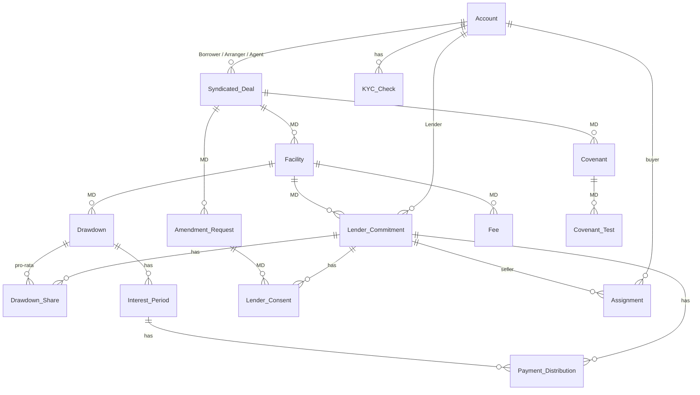

# 4. Data model

The complete model lives in [`schemas/`](../schemas/):

| File | Purpose |
|---|---|
| [`data-model.json`](../schemas/data-model.json) | **Single source of truth** (16 objects, 132 fields). Salesforce metadata is generated from it. |
| [`data-dictionary.md`](../schemas/data-dictionary.md) | Every object and field: type, required, picklist values, formulas, descriptions. Generated. |
| [`erd.md`](../schemas/erd.md) | Entity-relationship diagrams (Mermaid). Generated. |
| [`state-machines.md`](../schemas/state-machines.md) | Allowed status transitions per object. |
| [`events/`](../schemas/events/) and [`api/`](../schemas/api/) | JSON Schemas for platform events and the REST API. |

## Shape of the model



`MD` = Master-Detail. Full field-level diagrams: [`schemas/erd.md`](../schemas/erd.md).

## Design decisions worth knowing

1. **Hierarchy Deal → Facility → Commitment/Drawdown uses Master-Detail.** This gives cascade delete, inherited sharing and native roll-up summaries (Total Commitment, Drawn, Pending, Allocated) without code. Depth never exceeds Salesforce's limit of three levels. See [ADR-003](adr/ADR-003-master-detail-hierarchy.md).
2. **Institutions are `Account` records with a role multi-select**, not separate Borrower/Lender objects. See [ADR-002](adr/ADR-002-account-for-institutions.md).
3. **Lender-level money is stored, not derived.** `Allocated_Amount__c`, `Funded_Amount__c` and per-drawdown `Share_Amount__c` are persisted because they are legal facts at a point in time (and drive pro-rata), and must survive later assignment or re-allocation.
4. **Availability is a formula**: `Available_Amount__c = Commitment − Drawn (Funded) − Pending (Notified)`. Pending drawdowns reserve availability so two simultaneous requests cannot over-draw.
5. **Voting weight is a snapshot** (`Lender_Consent__c.Weight_Amount__c`), so a later assignment cannot change the outcome of a vote already circulated.
6. **Percent rates are stored as plain numbers (4.30 = 4.30%)** rather than Percent-typed fields, to avoid unit ambiguity between Apex, formulas and the UI.
7. **Field history tracking** is on the fields that matter for audit (status, amounts, rate, margin, CP flag). Beyond that, every state change publishes a `Loan_Event__e`.
8. **Money uses the org currency.** `Currency_Code__c` on the deal is informational. True multi-currency is on the roadmap ([09](09-roadmap-and-limitations.md)).

## Regenerating

```bash
python3 tools/generate_metadata.py   # rewrites force-app objects/fields/layouts/tabs/app/permission sets + schemas docs
python3 tools/validate_repo.py       # checks XML, JSON and that all code references exist in the model
```

CI fails if the committed metadata differs from what the generator produces, so the JSON and the Salesforce source cannot diverge.
