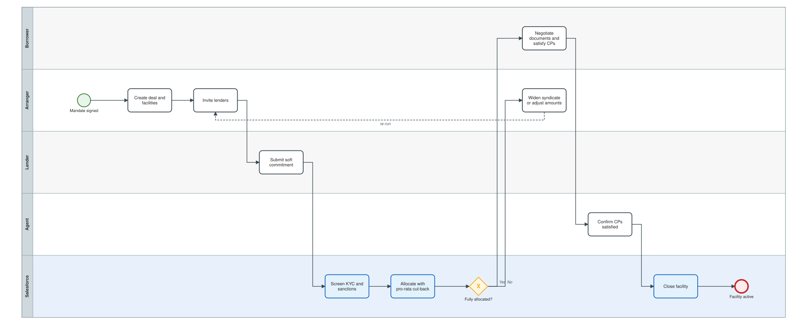
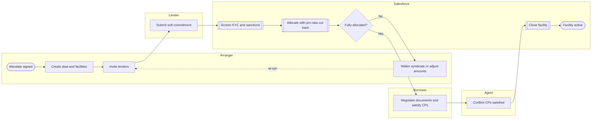

# Origination, bookbuilding and allocation

From signed mandate to an active facility: invitations, soft commitments, KYC/sanctions screening, pro-rata allocation, conditions precedent and closing.

Open the editable model: [`01-origination-and-allocation.bpmn`](01-origination-and-allocation.bpmn) (BPMN 2.0; works in bpmn.io, Camunda Modeler, Signavio import).

Legend: white box = manual task, blue box = automated by this project, diamond = exclusive gateway, dashed line = loop back.

Text version (Mermaid)

## Steps and implementation

| # | Step | Actor | Type | Implementation |
|---|---|---|---|---|
| 1 | Mandate signed | Arranger | Start event | Deal enters stage Mandate. |
| 2 | Create deal and facilities | Arranger | Manual task | `Syndicated_Deal__c`, `Facility__c` (tranche, pricing, maturity). |
| 3 | Invite lenders | Arranger | Manual task | `Lender_Commitment__c` created with Status = Invited. |
| 4 | Submit soft commitment | Lender | Manual task | Status = Soft Committed; `Soft_Commit_Amount__c` set. |
| 5 | Screen KYC and sanctions | Salesforce | Automated | `KycGuard.eligible()` - needs current Passed KYC and Sanctions checks. |
| 6 | Allocate with pro-rata cut-back | Salesforce | Automated | `SyndicationAllocator.allocate()` - largest-remainder split, idempotent, publishes `FACILITY_ALLOCATED`. |
| 7 | Fully allocated? | Salesforce | Gateway | Facility status becomes Allocated, otherwise stays Open for Commitments. |
| 8 | Widen syndicate or adjust amounts | Arranger | Manual task | Invite more lenders or lenders raise soft commitments, then re-run allocation. |
| 9 | Negotiate documents and satisfy CPs | Borrower | Manual task | Facility agreement signed; conditions precedent delivered. |
| 10 | Confirm CPs satisfied | Agent | Manual task | `Syndicated_Deal__c.CPs_Satisfied__c` = true. |
| 11 | Close facility | Salesforce | Automated | `ClosingService.close()` - commitments to Signed, facility Active, deal Active, publishes `FACILITY_CLOSED`. |
| 12 | Facility active | Salesforce | End event | Ready for drawdowns. |
