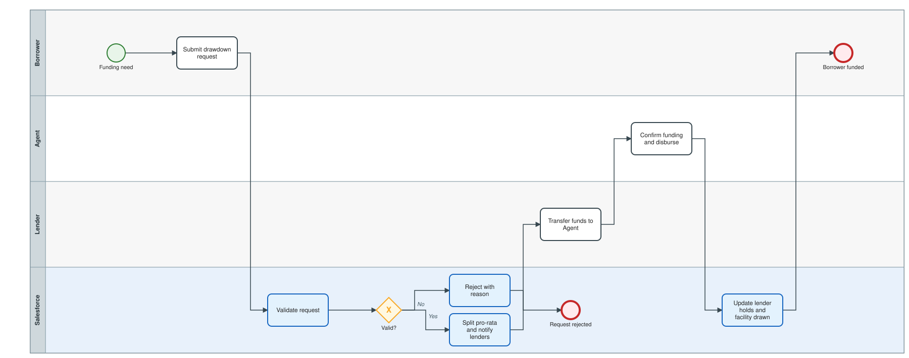
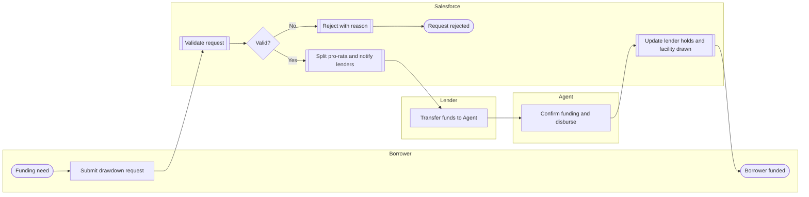

# Drawdown and funding

Borrower utilisation request, agent-side validation, pro-rata notice to every lender, funding confirmation and lender hold updates.

Open the editable model: [`02-drawdown-and-funding.bpmn`](02-drawdown-and-funding.bpmn) (BPMN 2.0; works in bpmn.io, Camunda Modeler, Signavio import).

Legend: white box = manual task, blue box = automated by this project, diamond = exclusive gateway, dashed line = loop back.

Text version (Mermaid)

## Steps and implementation

| # | Step | Actor | Type | Implementation |
|---|---|---|---|---|
| 1 | Funding need | Borrower | Start event | Facility must be Active. |
| 2 | Submit drawdown request | Borrower | Manual task | `DrawdownService.request()` or REST `POST /syndication/v1/drawdowns`. |
| 3 | Validate request | Salesforce | Automated | Facility Active, value date not past, within maturity and availability period, amount <= available. |
| 4 | Valid? | Salesforce | Gateway | Business-rule failures reject with a reason instead of raising an error. |
| 5 | Reject with reason | Salesforce | Automated | Status = Rejected; `Rejection_Reason__c`; publishes `DRAWDOWN_REJECTED`. |
| 6 | Request rejected | Salesforce | End event | Borrower is informed. |
| 7 | Split pro-rata and notify lenders | Salesforce | Automated | `LoanMath.split()` over allocated amounts; `Drawdown_Share__c` per lender; reserves availability; publishes `DRAWDOWN_NOTIFIED`. |
| 8 | Transfer funds to Agent | Lender | Manual task | Each lender funds its share by the value date. |
| 9 | Confirm funding and disburse | Agent | Manual task | `DrawdownService.confirmFunding()`. |
| 10 | Update lender holds and facility drawn | Salesforce | Automated | `Funded_Amount__c` per lender; Drawn roll-up; publishes `DRAWDOWN_FUNDED`. |
| 11 | Borrower funded | Borrower | End event | Interest accrues from the value date. |
