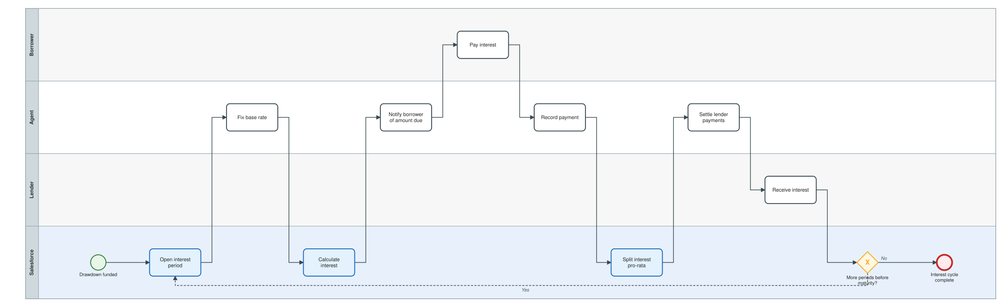
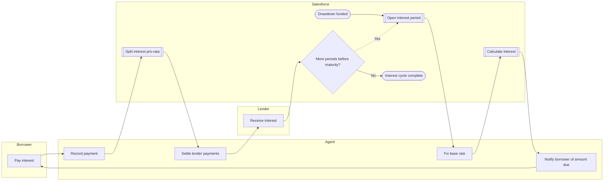

# Interest period and payment distribution

Rate fixing, interest calculation, borrower payment, exact pro-rata distribution to lenders and settlement, repeated each period until maturity or repayment.

Open the editable model: [`03-interest-and-distribution.bpmn`](03-interest-and-distribution.bpmn) (BPMN 2.0; works in bpmn.io, Camunda Modeler, Signavio import).

Legend: white box = manual task, blue box = automated by this project, diamond = exclusive gateway, dashed line = loop back.

Text version (Mermaid)

## Steps and implementation

| # | Step | Actor | Type | Implementation |
|---|---|---|---|---|
| 1 | Drawdown funded | Salesforce | Start event | Triggered once a drawdown is Funded. |
| 2 | Open interest period | Salesforce | Automated | `InterestService.openNext()` - start = value date or previous end; end capped at maturity. |
| 3 | Fix base rate | Agent | Manual task | `InterestService.fixRate()` or REST `POST /syndication/v1/rates`. |
| 4 | Calculate interest | Salesforce | Automated | `InterestService.calculate()` - principal x (max(base,0) + margin) x day-count fraction. |
| 5 | Notify borrower of amount due | Agent | Manual task | Interest notice. |
| 6 | Pay interest | Borrower | Manual task | Payment on the due date. |
| 7 | Record payment | Agent | Manual task | `InterestService.markPaid()`. |
| 8 | Split interest pro-rata | Salesforce | Automated | `InterestService.distribute()` - `Payment_Distribution__c` per lender, sum equals interest to the cent; publishes `INTEREST_DISTRIBUTED`. |
| 9 | Settle lender payments | Agent | Manual task | `InterestService.settleDistributions()` with payment-run reference. |
| 10 | Receive interest | Lender | Manual task | Lender books the income. |
| 11 | More periods before maturity? | Salesforce | Gateway | Next period opens only when the previous is Distributed. |
| 12 | Interest cycle complete | Salesforce | End event | Drawdown repaid or matured. |
