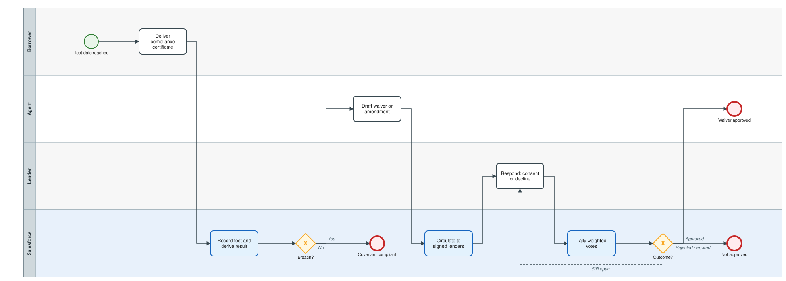
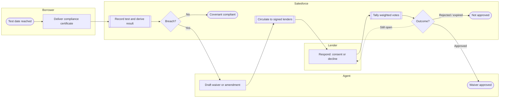

# Covenant testing, waivers and lender consent

Compliance certificate, automatic Pass/Breach derivation, waiver request circulation and commitment-weighted voting.

Open the editable model: [`04-covenant-and-consent.bpmn`](04-covenant-and-consent.bpmn) (BPMN 2.0; works in bpmn.io, Camunda Modeler, Signavio import).

Legend: white box = manual task, blue box = automated by this project, diamond = exclusive gateway, dashed line = loop back.

Text version (Mermaid)

## Steps and implementation

| # | Step | Actor | Type | Implementation |
|---|---|---|---|---|
| 1 | Test date reached | Borrower | Start event | Per covenant test frequency. |
| 2 | Deliver compliance certificate | Borrower | Manual task | Actual value for the covenant metric. |
| 3 | Record test and derive result | Salesforce | Automated | `CovenantTestTrigger` -> `CovenantService.evaluate()`; Maximum: actual <= threshold, Minimum: actual >= threshold. |
| 4 | Breach? | Salesforce | Gateway | Covenant status rolls to Compliant or Breached; publishes `COVENANT_BREACH`. |
| 5 | Covenant compliant | Salesforce | End event | No action needed. |
| 6 | Draft waiver or amendment | Agent | Manual task | `Amendment_Request__c` with required majority (66.67 or 100). |
| 7 | Circulate to signed lenders | Salesforce | Automated | `ConsentService.circulate()` - one `Lender_Consent__c` per lender, weight snapshot. |
| 8 | Respond: consent or decline | Lender | Manual task | `Lender_Consent__c.Response__c`. |
| 9 | Tally weighted votes | Salesforce | Automated | `LenderConsentTrigger` -> `ConsentService.tally()`. |
| 10 | Outcome? | Salesforce | Gateway | Approved when consenting weight >= threshold; Rejected once threshold unreachable; Expired after deadline. |
| 11 | Waiver approved | Agent | End event | Publishes `AMENDMENT_RESOLVED` (Approved). |
| 12 | Not approved | Salesforce | End event | Rejected or Expired; publishes `AMENDMENT_RESOLVED`. |
