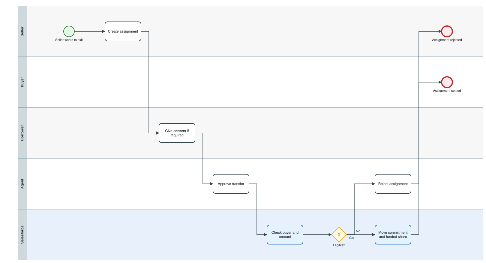
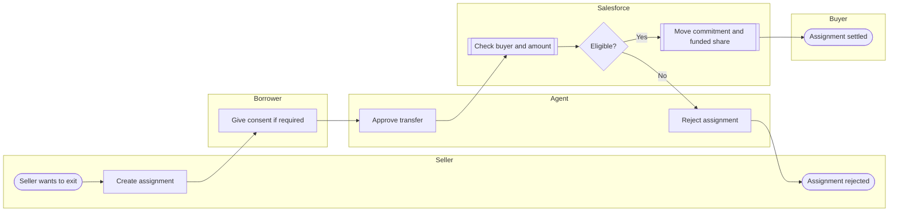

# Secondary-market assignment

Transfer of part or all of a lender's commitment to a new lender, gated by borrower consent, agent approval and buyer KYC/sanctions.

Open the editable model: [`05-secondary-assignment.bpmn`](05-secondary-assignment.bpmn) (BPMN 2.0; works in bpmn.io, Camunda Modeler, Signavio import).

Legend: white box = manual task, blue box = automated by this project, diamond = exclusive gateway, dashed line = loop back.

Text version (Mermaid)

## Steps and implementation

| # | Step | Actor | Type | Implementation |
|---|---|---|---|---|
| 1 | Seller wants to exit | Seller | Start event | Trade agreed bilaterally. |
| 2 | Create assignment | Seller | Manual task | `Assignment__c` (seller commitment, buyer, amount). |
| 3 | Give consent if required | Borrower | Manual task | Status = Pending Borrower Consent. |
| 4 | Approve transfer | Agent | Manual task | Status = Pending Agent Approval. |
| 5 | Check buyer and amount | Salesforce | Automated | `AssignmentService.settle()` - buyer passes KYC/sanctions; amount <= seller allocation. |
| 6 | Eligible? | Salesforce | Gateway | Failure raises a business error and leaves the assignment unsettled. |
| 7 | Reject assignment | Agent | Manual task | Status = Rejected. |
| 8 | Assignment rejected | Seller | End event | No change to holdings. |
| 9 | Move commitment and funded share | Salesforce | Automated | Allocated and funded amounts move seller -> buyer; publishes `ASSIGNMENT_SETTLED`. |
| 10 | Assignment settled | Buyer | End event | Buyer commitment is Signed. |
