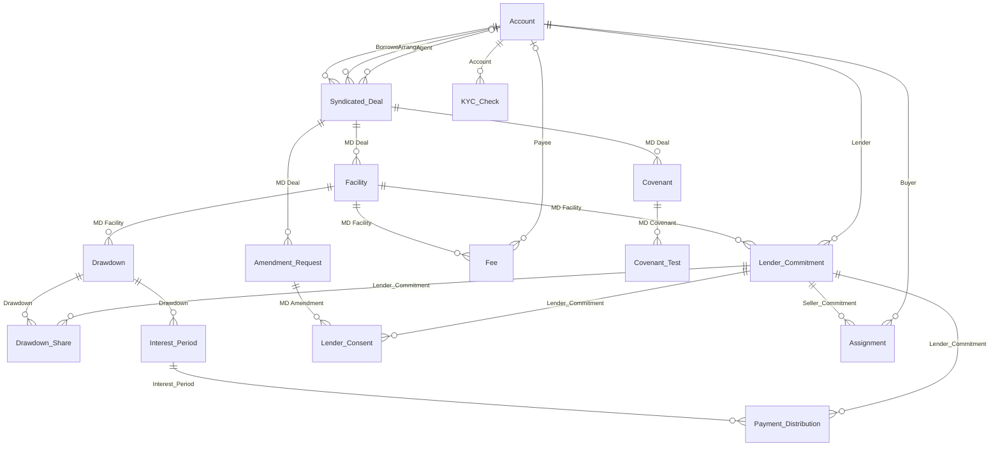
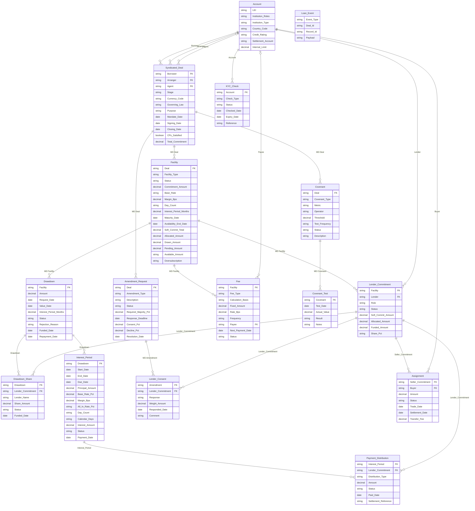

# Entity-relationship diagrams

> Generated by `tools/generate_metadata.py`. Renders natively on GitHub (Mermaid).

Legend: `MD` = Master-Detail (cascade delete, roll-ups, inherited sharing). Other lines are Lookups (`||` = required, `|o` = optional). Master-Detail depth never exceeds three levels.

## 1. Relationships overview

## 2. Full model with fields

