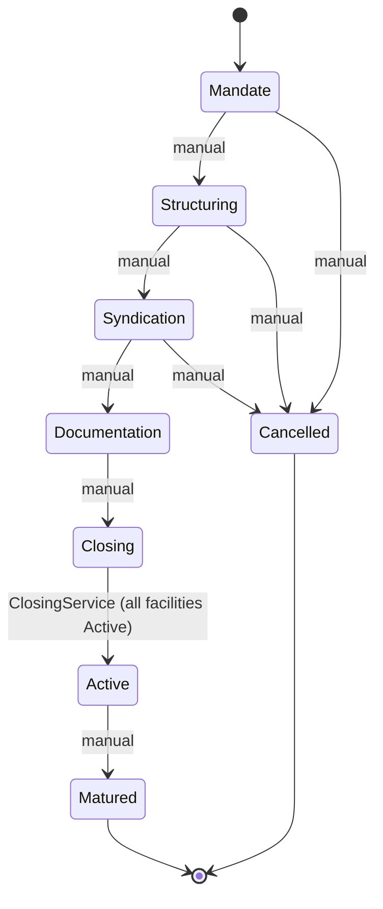
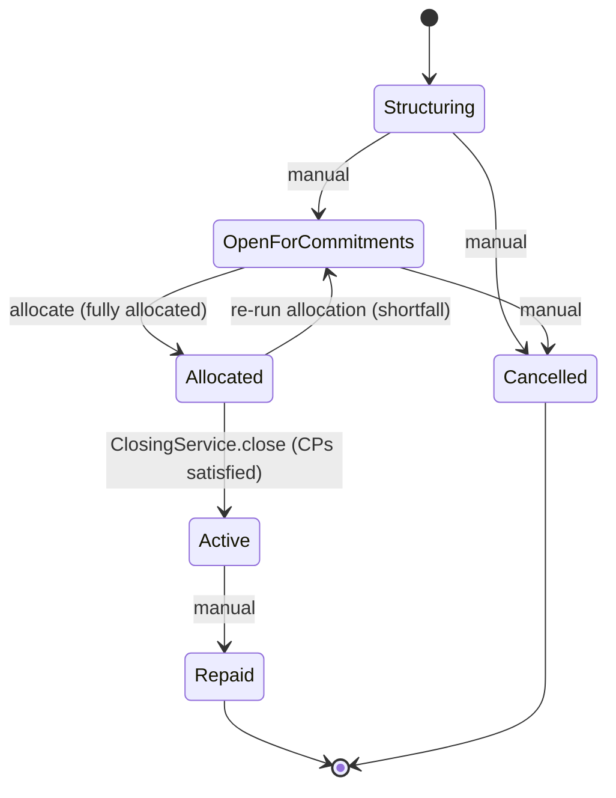
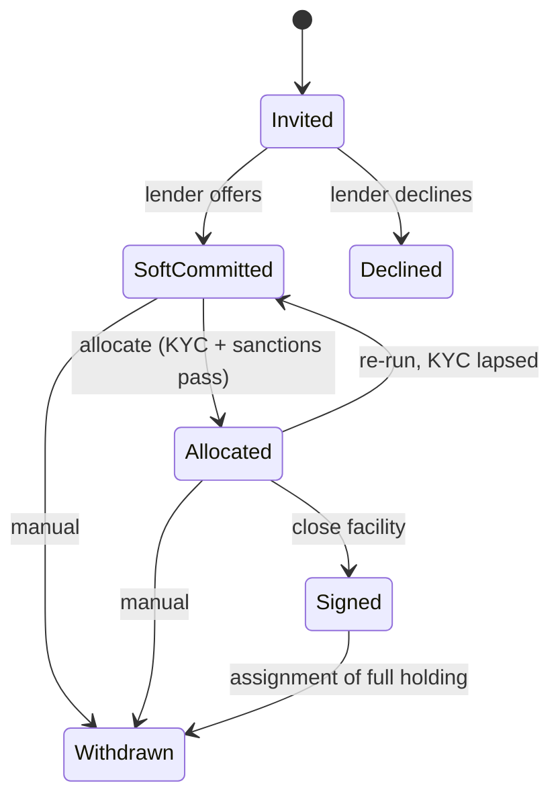
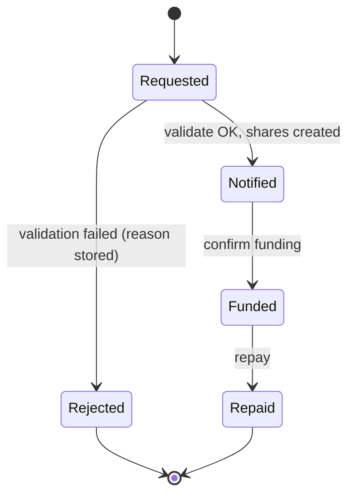
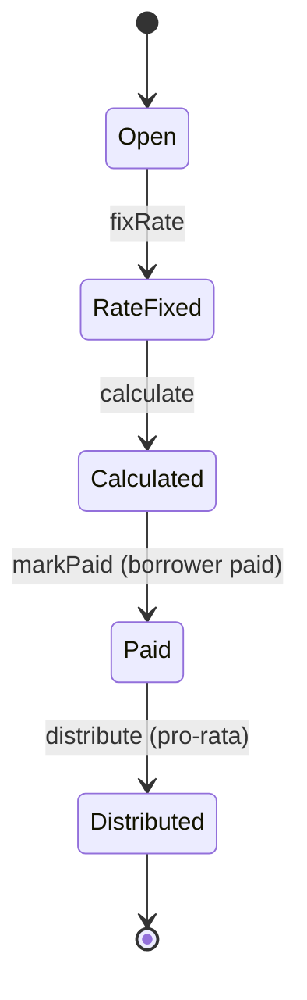
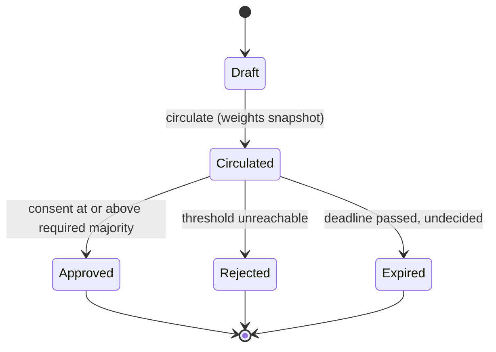
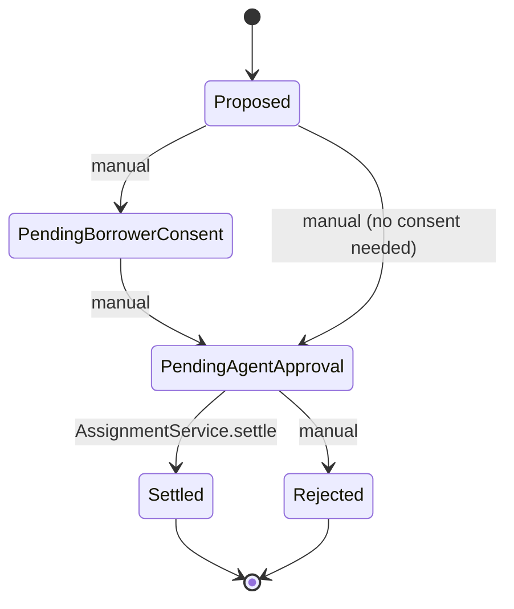
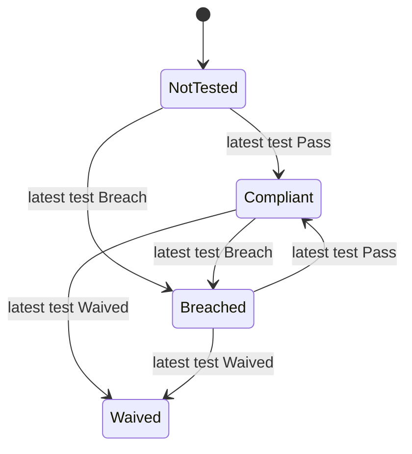

# State machines

Allowed status transitions per object. Solid arrows are enforced by the Apex services; entries marked *(manual)* are set by users or the standard UI and are not guarded in v0.1.

## Syndicated Deal — `Stage__c`

## Facility — `Status__c`

*OpenForCommitments* = "Open for Commitments".

## Lender Commitment — `Status__c`

## Drawdown — `Status__c`

## Interest Period — `Status__c`

## Amendment Request — `Status__c`

## Assignment — `Status__c`

## Covenant — `Status__c`

